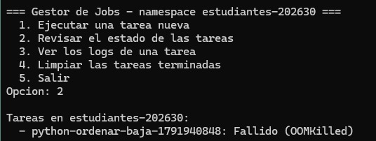
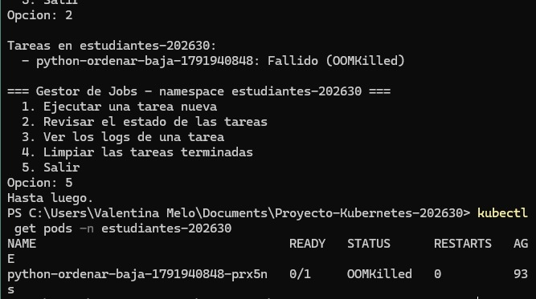
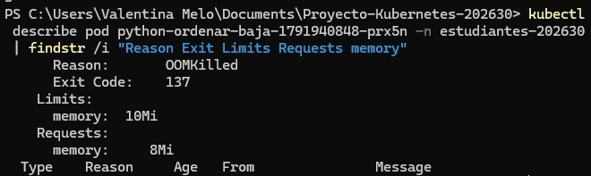

# Proyecto Kubernetes 202630 — Gestor de Jobs parametrizados

Proyecto grupal de **Estructura del Computador II**.

**Integrantes:** Valentina Melo · Maria Barros · Samuel De Lavalle

**Video del demo:** [VIDEO_DEMO_AQUI](https://www.youtube.com/)

---

## 1. Qué es

`entrega/gestor_jobs.py` es una herramienta de consola, escrita en Python, que lanza tareas en Kubernetes (Minikube) sin editar un YAML por cada ejecución. El usuario elige **lenguaje, tarea y complejidad** en un menú, y el programa crea un `Job` usando el cliente oficial de Kubernetes para Python (`kubernetes`). **No se invoca `kubectl` desde el código.**

El recorrido completo es:

```
gestor_jobs.py -> Job de Kubernetes -> Pod -> contenedor con argumentos -> logs
```

- **Job**: objeto que ejecuta una tarea hasta que termina. A diferencia de un servicio, no se queda vivo.
- **Pod**: lo crea el Job para correr el contenedor. Los logs pertenecen al Pod, no al Job.
- **Contenedor**: una de las tres imágenes (Python, Java o C), que recibe `<tarea> <N>` como argumentos, escribe logs en stdout y termina con una línea JSON.

## 2. Preparación

Requisitos usados: Windows 11, Docker Desktop, Minikube v1.39, kubectl, Git y Python 3.14 con la librería `kubernetes` 37.0.1.

Desde la carpeta raíz del proyecto, en PowerShell:

```powershell
minikube start --driver=docker --container-runtime=docker
kubectl apply -f .\k8s\00-namespace.yaml
powershell -ExecutionPolicy Bypass -File .\scripts\preparar-imagenes.ps1
pip install -r .\entrega\requirements.txt
```

Notas importantes:

- `--container-runtime=docker` es necesario: `preparar-imagenes.ps1` usa `minikube docker-env`, que no funciona con el runtime `containerd`.
- Hay que **volver a ejecutar `preparar-imagenes.ps1` cada vez que cambie el programa de un contenedor**. No se usa `minikube image load`, porque no reemplaza un tag que ya existe.
- `-ExecutionPolicy Bypass` evita el bloqueo de scripts `.ps1` de Windows solo para esa ejecución.

## 3. Uso

```powershell
python .\entrega\gestor_jobs.py
```

```
=== Gestor de Jobs - namespace estudiantes-202630 ===
  1. Ejecutar una tarea nueva
  2. Revisar el estado de las tareas
  3. Ver los logs de una tarea
  4. Limpiar las tareas terminadas
  5. Salir
```

Para contrastar el menú con lo que reporta el clúster:

```powershell
kubectl get jobs,pods -n estudiantes-202630
kubectl logs -n estudiantes-202630 job/<nombre-del-job>
```

## 4. Cómo está implementado

| Función | Qué hace |
|---|---|
| `seleccionar` | Pide lenguaje, tarea y complejidad. Toma la imagen y las tareas del catálogo, el N de `TAMANOS` y los recursos de `NIVELES`. |
| `crear_job` | Arma el objeto `V1Job` y lo envía con `create_namespaced_job`. |
| `describir_estado` | Traduce los contadores `active`, `succeeded` y `failed` del Job a texto. |
| `motivo_fallo` | Lee el estado del contenedor dentro del Pod para obtener la causa de un fallo (por ejemplo `OOMKilled`). |
| `listar_jobs` | Lista los Jobs del namespace con su estado; si un Job falló, agrega la causa. |
| `consultar_logs` | Busca el Pod por la etiqueta `job-name=<nombre>` y lee sus logs. |
| `jobs_terminados` | Selecciona los Jobs sin Pods activos y con algún Pod correcto o fallido. No toca los que siguen corriendo. |
| `eliminar_job` | Borra el Job con `propagation_policy="Background"`, que también elimina sus Pods. |

### Decisiones sobre el Job

| Campo | Valor | Por qué |
|---|---|---|
| `image_pull_policy` | `Never` | La imagen ya está dentro de Minikube; Kubernetes no debe buscarla en un registro. |
| `restart_policy` | `Never` | Si el contenedor termina o muere, el Pod no se reinicia. |
| `backoff_limit` | `0` | Sin reintentos: un fallo (por ejemplo `OOMKilled`) deja el Job en `Failed` de inmediato y se puede ver. |
| `requests` / `limits` | según la complejidad | `requests` es lo que Kubernetes reserva para programar el Pod; `limits` es el tope. Superar el límite de memoria mata el contenedor con `OOMKilled`; superar el de CPU solo lo frena. |

### Qué significa la complejidad

La complejidad (`baja`, `media`, `alta`) fija dos cosas a la vez:

| Nivel | CPU request / limit | Memoria request / limit |
|---|---|---|
| baja | 100m / 500m | 64Mi / 128Mi |
| media | 250m / 1000m | 128Mi / 512Mi |
| alta | 500m / 2000m | 256Mi / 1Gi |

Y el valor de N que recibe la tarea:

| Tarea | baja | media | alta |
|---|---|---|---|
| `hola` | — | — | — |
| `ordenar` | 100.000 | 1.000.000 | 3.000.000 |
| `fib` | 25 | 30 | 35 |
| `matriz` | 60 | 120 | 250 |
| `primos` | 1.000.000 | 10.000.000 | 50.000.000 |

## 5. Tarea adicional: `primos` (Python)

Cuenta los números primos hasta N con la **criba de Eratóstenes**.

- Usa una tabla de N+1 bytes (`bytearray`), así que la memoria crece de forma lineal con N: CPU y memoria a la vez.
- **Verifica su resultado**: para valores conocidos de N compara con el conteo esperado y falla si no coincide, en vez de reportar éxito.
- Cambios necesarios: la función en `imagenes/python/tareas.py`, la tarea en `catalogo/tareas.json`, su fila en la tabla `TAMANOS` del gestor y reconstruir la imagen.

Resultado en el clúster, nivel `alta` (N = 50.000.000):

```json
{"tarea": "primos", "lenguaje": "python", "ms": 1599, "n": 50000000, "cantidad": 3001134, "ultimo": 49999991}
```

Hay 3.001.134 primos hasta 50.000.000, que es el valor correcto.

## 6. Pruebas y resultados

### 6.1 Comparación de lenguajes: `fib(35)` (nivel alta)

| Lenguaje | Cálculo (`ms`) | Duración del Job | Veces más lento que C |
|---|---|---|---|
| C | 20 | 3 s | 1× |
| Java | 61 | 3 s | ~3× |
| Python | 1453 | 4 s | ~72× |

Las tres dan el mismo resultado (`fib(35) = 9227465`).

- **C** se compila a código máquina antes de ejecutarse.
- **Java** compila a bytecode y la JVM lo optimiza mientras corre (JIT).
- **Python** es interpretado: cada llamada recursiva pasa por el intérprete.

`ms` mide **solo el cálculo dentro del contenedor**. La duración del Job incluye además la creación y el arranque del Pod, y esos ~3 s son sobrecosto de Kubernetes, no del cálculo.

### 6.2 La tarea `hola` en los tres lenguajes (nivel baja)

| Lenguaje | Duración del Job |
|---|---|
| C | 4 s |
| Java | 4 s |
| Python | 5 s |

La duración de `kubectl get jobs` se redondea a segundos y el sobrecosto de Kubernetes es del mismo orden. Con esta resolución **no se distingue** el costo de arranque de la JVM frente a Python o C.

### 6.3 `OOMKilled` provocado

Con `ordenar` (N = 100.000, nivel baja) y `python`:

| `mem_request` / `mem_limit` | Resultado |
|---|---|
| 8Mi / 16Mi | Completado |
| 8Mi / 10Mi | `OOMKilled` |

El menú muestra `Fallido (OOMKilled)` y `kubectl get pods` muestra el mismo Pod con `STATUS: OOMKilled`. Además, `kubectl describe pod` confirma `Reason: OOMKilled` y `Exit Code: 137`, con un límite de memoria de 10Mi y una solicitud de 8Mi. El código de salida 137 equivale a 128 + 9: el kernel terminó el proceso con la señal 9 por pasarse del límite. Después de la prueba se restauraron los valores originales de `NIVELES`.

Menú del gestor (opción 2):



El mismo Job visto desde el clúster, contrastado con el menú:



Detalle del Pod:



### 6.4 Limpieza

La opción 4 lista los Jobs terminados, pide confirmación y los elimina. Después, `kubectl get jobs,pods -n estudiantes-202630` responde `No resources found`: los Pods se borran junto con su Job gracias a `propagation_policy="Background"`.

## 7. Problemas encontrados y cómo se resolvieron

| Problema | Causa | Solución |
|---|---|---|
| `docker-env ... containerd runtime ... not yet supported` al construir las imágenes | El clúster se había creado con el runtime `containerd` | `minikube delete` y `minikube start --driver=docker --container-runtime=docker` |
| `la ejecución de scripts está deshabilitada` | Política de ejecución de PowerShell | `powershell -ExecutionPolicy Bypass -File .\scripts\preparar-imagenes.ps1` |
| El menú ofrecía una tarea llamada `Ellipsis` | Seguía el esqueleto original: el `...` de un `TODO` sin completar | Reemplazar `gestor_jobs.py` por la versión completa |
| El `OOMKilled` no ocurría aunque se bajó `mem_limit` | El gestor ya estaba abierto y Python lee `NIVELES` al arrancar; además 16Mi alcanzaba | Cerrar y volver a abrir el gestor, y bajar el límite a 10Mi |

## 8. Estructura del repositorio

```
catalogo/tareas.json            catálogo de lenguajes, imágenes y tareas
entrega/gestor_jobs.py          gestor con el menú
entrega/requirements.txt        dependencias de Python
imagenes/{python,java,c}/       imágenes con las tareas
k8s/00-namespace.yaml           namespace estudiantes-202630
scripts/preparar-imagenes.ps1   construye las imágenes dentro de Minikube
docs/capturas/                  capturas de las pruebas
```
